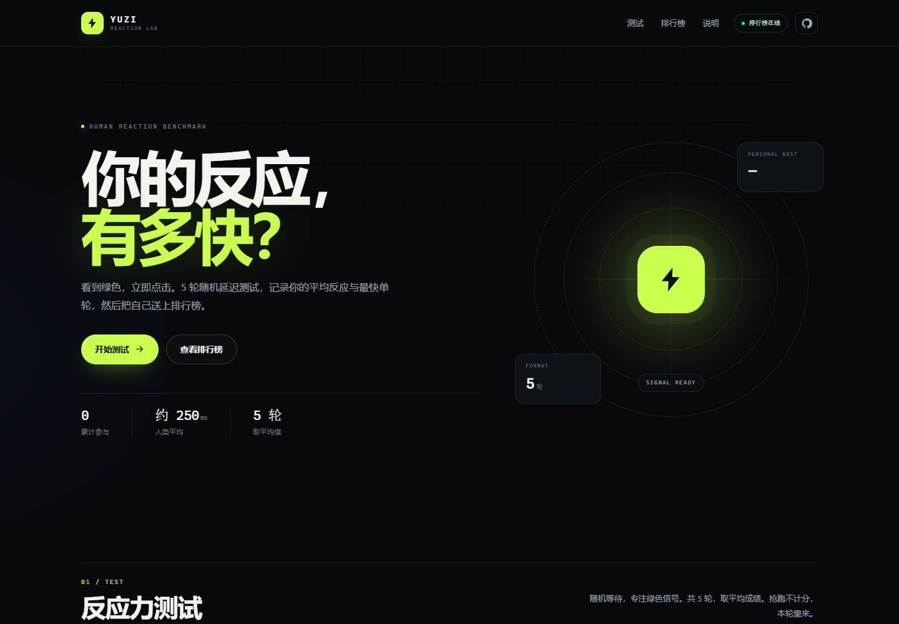
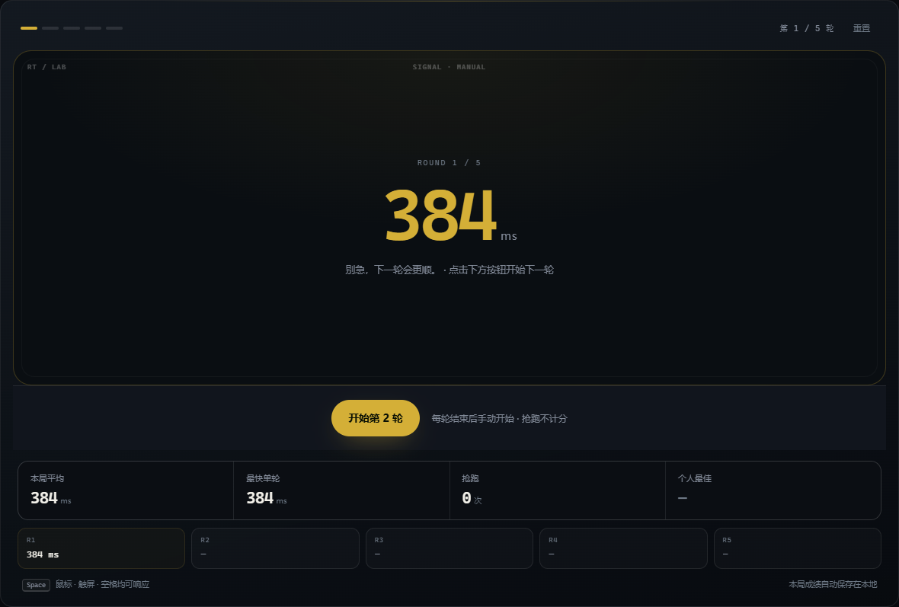
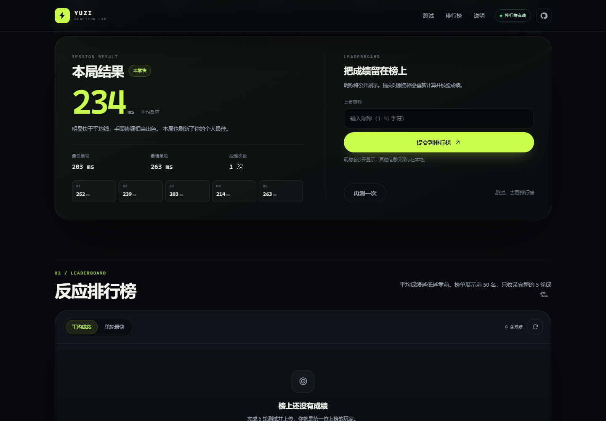
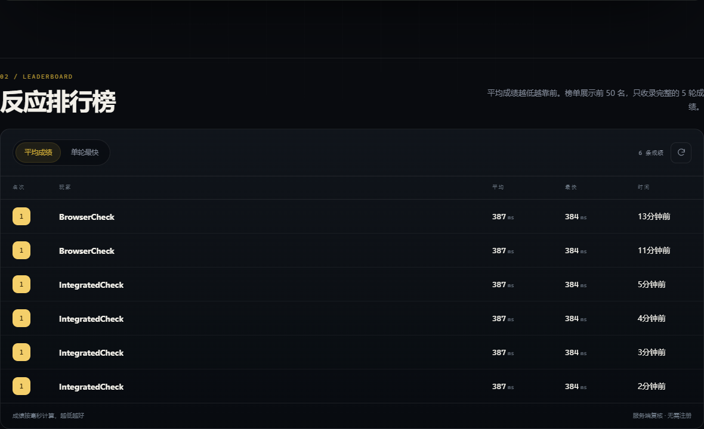

# Yuzi Reaction Time Test

## 2026-10-27：预测成绩与连续抢跑

任一轮原始反应时间小于80ms，整次五轮成绩取消，不保存或上传；80ms有效。服务端对玩家上传、管理编辑执行相同门槛，历史低于80ms的记录保留供管理员查看，但不再计入公开排行、人数或个人前五局。本地最佳也排除预测成绩。

一次测试累计第六次抢跑时自动清空成绩并重新开始五轮，前五次仍点击原区域重试当前轮。取消或重启同时清理计时器和动画帧，避免旧绿灯污染新测试。

## 2026-10-26：账号最佳成绩与管理接口

网站账号榜按每个账号最低的五轮平均值排序，只显示该局对应的单轮最快值。历史成绩保留，预览为前10位，`?board=1` 查看前100位并展开每位用户平均成绩最好的前5局。

新增 `GET /api/leaderboard/accounts/:accountId` 返回最多5局详情。内部 `/api/admin/scores` 支持分页查询、PUT编辑五轮成绩、DELETE删除；编辑/删除带版本防止覆盖其他管理员改动。`DELETE /api/admin/accounts/:accountId/scores` 删除指定账号的全部历史。接口需要网站服务密钥 `X-Website-Key` 或独立管理令牌 `X-Admin-Token`，仅由受权限保护的网站API调用，密钥不进入浏览器。

SQLite启动只新增版本列和索引，不删除旧数据；旧匿名成绩继续保留，且不会被猜测关联到网站账号。网站排名与人数均按账号计算；独立匿名API保留原排序兼容行为。

**5 轮随机延迟的人类反应力测试，带自托管排行榜。**

看到绿色，立即点击。记录平均反应、单轮最快与个人最佳，然后把成绩留在榜上。




## 功能

- **5 轮反应测试**：随机等待 1.4–3.8 秒后亮起绿色；提前点击会被判为抢跑；出成绩、抢跑或页面切换后均需手动点击按钮再开始，不自动连测。
- **完整结算**：本局平均、最快/最慢单轮、抢跑次数、评级与个人最佳。
- **双排行榜**：按平均成绩或单轮最快排序，提交后显示名次和击败百分比。
- **本地优先**：个人历史（最近 30 局）和昵称保存在 `localStorage`；服务器离线时测试仍可用。
- **纯前端零构建**：HTML + CSS + 原生 JavaScript，不依赖框架或打包工具。
- **服务端校验**：服务端重新计算平均与最快成绩，限制昵称和成绩范围，并按 IP 限流。
- **可维护**：可选管理员令牌删除违规成绩；SQLite 单文件存储，备份简单。
- **多端适配**：鼠标、触屏、空格键均可响应；支持移动端布局与 `prefers-reduced-motion`。

## 界面预览







## 快速开始

需要 **Node.js 22.5 或更高版本**（后端使用内置 `node:sqlite`，无需编译原生模块）。

```bash
git clone https://github.com/YuGaN525/Yuzi_ReactionTimeTest.git
cd Yuzi_ReactionTimeTest
npm install
npm start
```

打开 <http://localhost:3000>。

开发时可以使用：

```bash
npm run dev   # node --watch，修改服务端文件后自动重启
```

数据库会自动创建在 `data/leaderboard.db`（已被 `.gitignore` 忽略）。

### 不用服务器，直接打开前端

直接打开 `public/index.html` 即可完成测试，个人成绩会保存在本地。排行榜此时处于「本地模式」，无法上传或读取线上成绩。

要让一个独立托管的前端连接线上 API：

1. 修改 `public/index.html` 中的 `<meta name="api-base" content="">`，例如填入 `https://api.example.com`。
2. 在 API 服务器上设置 `CORS_ORIGINS=https://你的前端域名`。
3. 如果前端所在服务器会下发 CSP，额外设置 `CSP_CONNECT_SRC=https://api.example.com`。

## 部署

### Docker Compose

```bash
docker compose up -d --build
```

数据保存在名为 `yuzi-data` 的 Docker 卷中。需要删除违规成绩时，先启用管理令牌：

```bash
ADMIN_TOKEN=替换成随机长字符串 docker compose up -d
```

### Docker CLI

```bash
docker build -t yuzi-reaction .
docker run -d --name yuzi-reaction -p 3000:3000 \
  -v yuzi-data:/app/data \
  -e ADMIN_TOKEN=替换成随机长字符串 \
  yuzi-reaction
```

### 反向代理与平台部署

- 部署到 VPS、Railway、Render、Fly.io 等平台时，请为 `/app/data` 挂载持久化磁盘；否则容器重建后排行榜会丢失。
- 反向代理后面运行时设置 `TRUST_PROXY=1`，并确保 `X-Forwarded-For` 正确传递，否则限流会把所有访客当作同一个 IP。
- SQLite 适合单实例部署。不要同时运行多个副本共享同一个数据库文件。

Nginx 反向代理示例：

```nginx
location / {
    proxy_pass http://127.0.0.1:3000;
    proxy_set_header Host $host;
    proxy_set_header X-Real-IP $remote_addr;
    proxy_set_header X-Forwarded-For $proxy_add_x_forwarded_for;
    proxy_set_header X-Forwarded-Proto $scheme;
}
```

## 配置

所有配置通过环境变量传入，无配置文件。

| 变量 | 默认值 | 说明 |
| --- | --- | --- |
| `PORT` | `3000` | HTTP 监听端口 |
| `DATA_DIR` | `./data` | SQLite 数据目录，相对项目根目录解析 |
| `ADMIN_TOKEN` | 空 | 设置后才启用 `DELETE /api/scores/:id` |
| `TRUST_PROXY` | `0` | 反向代理后设为 `1`，用于获取真实客户端 IP |
| `RATE_LIMIT_MAX` | `8` | 每个 IP 在限流窗口内允许的提交次数 |
| `RATE_LIMIT_WINDOW_MS` | `600000` | 限流窗口（毫秒），默认 10 分钟 |
| `CORS_ORIGINS` | 空 | 允许跨域的前端源，逗号分隔 |
| `CSP_CONNECT_SRC` | 空 | 额外的 CSP `connect-src` 源，用于前后端分离 |

限流计数保存在内存中，重启服务后会清零。

## API

### `GET /api/health`

```json
{ "ok": true, "total": 42, "uptime": 3600 }
```

### `GET /api/leaderboard?sort=avg&limit=50`

- `sort`：`avg`（默认，平均成绩榜）或 `best`（单轮最快榜）。
- `limit`：1–100，默认 50。

```json
{
  "sort": "avg",
  "limit": 50,
  "total": 42,
  "entries": [
    {
      "rank": 1,
      "id": 12,
      "name": "Yuzi",
      "avgMs": 198,
      "bestMs": 176,
      "createdAt": "2026-10-25T09:00:00.000Z"
    }
  ]
}
```

### `POST /api/scores`

```bash
curl -X POST http://localhost:3000/api/scores \
  -H 'Content-Type: application/json' \
  -d '{"name":"Yuzi","rounds":[214,198,231,220,205]}'
```

- `name`：1–16 个可见字符。
- `rounds`：恰好 5 个数字，每轮 50–5000 ms。
- 服务端重新计算平均值和最快值，忽略客户端传入的 `avgMs` / `bestMs`。

成功返回 `201`，并附带服务器计算的 `rank`、`percentile`、`total`：

```json
{
  "score": {
    "id": 13,
    "name": "Yuzi",
    "avgMs": 214,
    "bestMs": 198,
    "rounds": [214, 198, 231, 220, 205],
    "createdAt": "2026-10-25T09:05:00.000Z"
  },
  "rank": 3,
  "percentile": 87,
  "total": 42
}
```

### `DELETE /api/scores/:id`

需要请求头 `X-Admin-Token`。仅在服务器设置了 `ADMIN_TOKEN` 时可用，成功返回 `204`。用于清理违规昵称或明显作弊的成绩。

```bash
curl -X DELETE http://localhost:3000/api/scores/13 \
  -H 'X-Admin-Token: 你的管理令牌'
```

## 测试

```bash
npm test
```

使用 Node.js 内置测试运行器，覆盖页面/健康检查、成绩校验、排序与排名、管理员删除和限流；已在 Node 22 与 Node 24 上验证通过。

## 项目结构

```text
public/
  index.html          页面结构
  styles.css          视觉与响应式布局
  app.js              测试状态机、本地存储、排行榜交互
  favicon.svg
 404.html
src/
  app.js              Express 应用、校验、路由、限流
  db.js               SQLite 初始化与成绩存储
server.js             服务入口与配置
test/api.test.js      API 集成测试
Dockerfile
compose.yaml
```

## 数据与公平性

- 服务器只保存昵称、5 轮成绩、平均/最快成绩和时间戳；**不会把 IP 写入数据库**，IP 仅用于内存限流。
- 昵称会公开显示，请提醒玩家不要使用真实姓名、联系方式等敏感信息。
- 这是浏览器端的娱乐级反应力测试。显示器刷新率、输入设备延迟、页面渲染调度都会影响结果，不适用于医学或科研测量。
- 服务器会复算成绩并校验范围，但无法阻止修改过的客户端或脚本模拟点击。对于公开榜单，建议设置 `ADMIN_TOKEN` 并定期清理异常成绩。

## License

[MIT](LICENSE) © 2026 YuGaN525

## 2026-10-25：手动轮次与 Yuz1 S0ft 主题

- 每个有效结果后停留在成绩页，点击「开始第 n 轮」才再次随机等待；抢跑点击「重试本轮」，失焦/切换页面点击「继续本轮」。第五轮结算后不会自动开新局。
- 绿灯在 requestAnimationFrame 中呈现并取 performance.now 时间戳；信号区不做颜色渐变或淡入。重置/页面离开会取消待执行的计时与信号帧，多点触屏与键盘长按不会重复触发。
- 与主项目一致的黑金（#D4AF37）/纸白浅色、字号、圆角与品牌；主题在本机保存。保留鼠标、触屏、键盘、个人历史与原排行榜。
- 支持同源嵌入：`?embed=1` 隐藏独立外壳；`meta api-prefix` 可设置网站代理前缀；标准Yuzibei响应自动解包。嵌入高度消息校验同源，主题通过同源storage事件同步。独立服务仍保持禁止跨站iframe的CSP，主站使用静态副本嵌入，不放宽该限制。

浏览器回归：安装可选Playwright后，在**临时数据目录的本地测试服务**上运行 `node tools/check-browser.cjs`。可设 `REACTION_TEST_URL=http://127.0.0.1:3001`、`BROWSER_CHANNEL=msedge`；独立工具环境可通过 `PLAYWRIGHT_MODULE_PATH` 指定模块路径。检查五轮手动推进、抢跑、暂停、清理、键盘长按、触屏、排行榜真实提交及四档屏宽。后端仍用 `npm test`。


### 网站账号排行榜（可选集成）

网站部署设置 `REQUIRE_ACCOUNT=1` 和至少32字符的 `WEBSITE_KEY`。提交仅接受携带匹配服务密钥的内部网站API，账号由网站后端读取，浏览器不能指定上榜身份。服务密钥不能放进前端。五轮完成后由同源父页面认证上传，测试使用UUID幂等标识，重试不重复记分。榜单姓名链接至网站公开个人主页。旧匿名记录保留在数据库，但账号榜不展示、不会按昵称猜测绑定用户。

每轮结果、抢跑、暂停后，直接点击原来的大测试区域或按空格/Enter继续；不会自动开始下一轮。反应数据下方显示当前n/5次。
